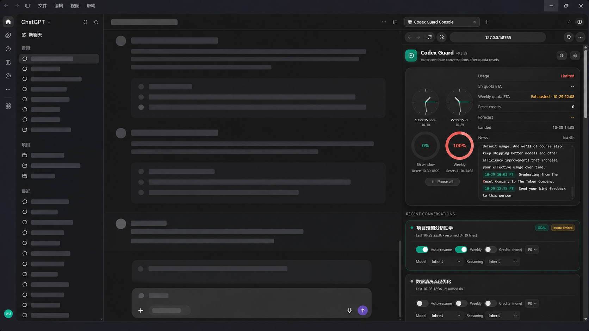
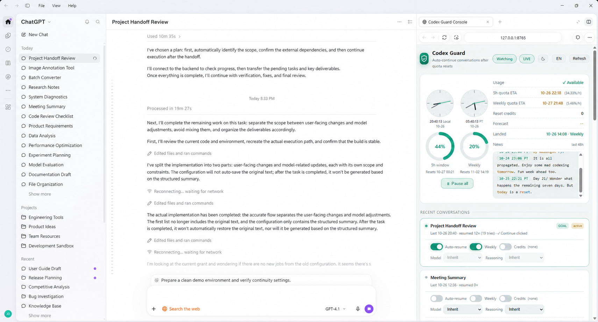

# Codex Guard

<p align="center">
  <b>Unattended auto-continue for OpenAI Codex.<br>
  额度重置后自动继续任务 —— 无人值守的 Codex 守护。</b>
</p>

<p align="center">
  <a href="#english">English</a> · <a href="#中文文档">中文文档</a> ·
  <a href="#for-ai-agents--面向-ai-agent">For AI Agents</a> ·
  <a href="#screenshots--效果图">Screenshots</a> ·
  License: MIT · Platform: Windows 10/11 · Panel: <code>http://127.0.0.1:8765</code>
</p>

---

<a id="screenshots--效果图"></a>
## Screenshots / 效果图

The guard panel docked in the Codex sidebar browser — dark and light.

守护面板嵌在 Codex 侧栏浏览器中的样子——深色与浅色。

<p align="center">
  
  <br><sub>Dark / 深色</sub>
</p>

<p align="center">
  
  <br><sub>Light / 浅色</sub>
</p>

---

<a id="english"></a>
## English

### ✨ Why Codex Guard

When ChatGPT's usage limit interrupts a Codex conversation — the 5-hour
window or the weekly quota — most people just wait and re-prompt by hand.
Codex Guard does that for you, and it does it the way you would:

- **Truly unattended.** Detects the interruption, waits for the quota
  window, resumes the thread — for ordinary conversations *and* `/goal`
  threads. Survives daemon restarts; every resume is verified.
- **Goals continue the official way.** When the desktop app holds the
  thread, Guard clicks the app's own **Resume goal** button through UI
  Automation (exactly your click); when it doesn't, it uses the official
  `thread/goal/set` API. It **never** injects fake chat messages.
- **Per-resume model & reasoning.** Each conversation can pin its own
  model and reasoning effort for every automatic resume, or inherit.
- **Weekly quota guard + reset credits.** Optionally keeps a goal alive
  across the weekly reset, and can spend an official reset credit
  automatically when the weekly quota runs dry (opt-in per thread).
- **A control panel worth opening.** Dark & light themes (follows your
  system, remembers your pick), bilingual (CN/EN), dual analog clocks
  (local + Pacific), pressure-colored quota rings, the
  official reset forecast / observed landing / merged Tibo news timeline
  (reset tracker plus two X mirrors, refreshed every 2 minutes) — served on
  `127.0.0.1:8765`, costs no quota.
- **Updates itself from the panel.** The guard checks GitHub for a newer
  release once a day. When one exists, a small red dot appears on the
  logo — click it, confirm, and the guard updates itself and restarts
  (source checkout: fast-forward `git pull`; pip install: `pip install -U`),
  reconnecting the panel when it is back.
- **Private and honest by design.** Reads Codex's local databases
  read-only, one lightweight usage HTTP poll through your system proxy,
  no telemetry, no accounts, localhost-only panel. Every ETA shown is
  measured — when something can't be measured it shows `--` instead of
  inventing a number.

### 🚀 30-second start

Prerequisites: Windows 10/11 · Python 3.11+ with pip · Codex app/CLI 26.x
(codex-cli ≥ 0.16x). Install the package into the Python that is on your
PATH.

```bash
git clone https://github.com/Awenforever/codex-autoresume.git
cd codex-autoresume
pip install .                                    # 1. python package
codex plugin marketplace add <path-to-repo>      # 2. local marketplace
codex plugin add codex-autoresume-guard@codex-autoresume   # 3. plugin
codex-autoresume install                         # 4. background daemon
```

Step 4 needs no administrator: when the logon scheduled task is denied, the
installer falls back to a per-user Startup-folder shortcut and starts the
daemon immediately.

Then open **http://127.0.0.1:8765** in the Codex sidebar browser (or any
local browser) and flip **Auto-resume** on the conversations you want
guarded. That's the whole flow — guarding is opt-in per conversation.

**Or let Codex install it for you.** Codex is an agent — paste this into a
Codex conversation and approve its commands:

```text
Install Codex Guard for me:
1. git clone https://github.com/Awenforever/codex-autoresume.git to a temp dir
2. cd there and run pip install .
3. run codex plugin marketplace add <that dir>, then
   codex plugin add codex-autoresume-guard@codex-autoresume
4. run codex-autoresume install (a denied admin task auto-falls back), then
   codex-autoresume doctor
Do NOT restart my Codex app. Report the panel URL when done.
```

Uninstall:

```bash
codex-autoresume uninstall                                  # daemon
codex plugin remove codex-autoresume-guard@codex-autoresume # plugin
codex plugin marketplace remove codex-autoresume            # marketplace
```

Upgrade an existing install:

The panel checks GitHub for a newer release once a day. When one exists, a
small red dot appears on the Codex Guard logo — click it, confirm, and the
guard updates itself and restarts (source checkout: `git pull --ff-only`;
pip install: `pip install -U` against `[update] pip_source`), and the panel
reconnects automatically. Self-update needs a clean checkout with an
upstream, or a pip install with a configured `pip_source`; disable it with
`[update] enabled = false`.

Manual upgrade (fallback):

```bash
git pull --ff-only                    # in the cloned repo / local marketplace
pip install -U .                      # same Python that provides codex-autoresume
codex plugin add codex-autoresume-guard@codex-autoresume   # re-add = upgrade cache
schtasks /End /TN codex-autoresume    # stop the running daemon …
timeout /t 3 /nobreak >nul
schtasks /Run /TN codex-autoresume    # … and start the new code
```

Re-running `codex plugin add` upgrades in place — no `remove` needed.
`codex plugin marketplace upgrade` only refreshes Git marketplaces; a local
clone is read directly, so `git pull` is enough. The panel header shows the
**running** daemon's version next to the title — if it still shows the old
number after an update, the daemon has not been restarted.

### ⚙️ How it works

```
codex  ──▶  "You've hit your usage limit … try again at 1:51 PM."
                                        │
detect    read-only scan of ~/.codex    │  goal parked? turn failed?
          (sqlite + goals db)           │
        ▼                               │
plan      block model: wait for the 5h  │  resume when quota headroom
          window; weekly tracked across │  shows — no grace, no fake
          blocks via pooled t-ratio     │  numbers, `--` when unknown
        ▼                               │
resume    /goal  → thread/goal/set (official API), or the app's own
          "Resume goal" button via UIA when the app holds the writer
          thread  → `codex exec resume` with your model/effort,
          falling back to the app queue
        ▼
verify    goal status must actually flip; counters and state persist
```

Guarding is **opt-in** (per conversation, from the panel). Detection is
read-only. The daemon runs as the current user, no administrator needed.

### 🤖 For AI agents / 面向 AI Agent

If you are an agent setting this up for a user, the whole job is four
commands (above) plus these checks:

```bash
codex-autoresume doctor        # every line should say [ok]
codex plugin list              # codex-autoresume-guard: installed, enabled
curl http://127.0.0.1:8765/api/status   # JSON with quota + threads
```

Do **not** hand-edit `~/.codex-autoresume/state.json` (the daemon owns it).
Strict config validation rejects unknown keys in `config.toml`. Do not
restart the user's Codex app. Guarding is armed per conversation from the
panel or `codex-autoresume watch <uuid|goal>`.

### 🧩 Configuration

Optional `~/.codex-autoresume/config.toml` (copy
[`config.example.toml`](config.example.toml); unknown keys are rejected):

```toml
[general]
poll_interval_sec = 50      # daemon heartbeat
weekly_resume = "off"       # off | per-thread | all

[resume]
mode = "exec"               # "queue" delivers into the desktop app instead
model = ""                  # "" keeps each thread's own model
reasoning_effort = ""

[control_api]
port = 8765                 # the panel

[update]
enabled = true              # red-dot self-update in the panel
```

### ⌨️ CLI

| Command | What it does |
|---|---|
| `daemon [--once] [-v]` | run the watcher loop (foreground) |
| `status` | tracked threads, quota snapshot |
| `watch <uuid\|goal> [--last]` | arm a thread for auto-continue |
| `unwatch <uuid>` | stop guarding a thread |
| `pause` / `resume` | pause / unpause all auto-resumes |
| `resume-now <uuid\|goal>` | one resume attempt immediately |
| `goals` | list Codex goal threads and their status |
| `limits` | quota snapshot JSON (windows + reset credits) |
| `install` / `uninstall` | register/remove the unattended runner |
| `doctor` | environment self-check |

### 🩺 Troubleshooting

- **Panel shows `--`** — that quota/ETA is not currently measurable; it
  fills in as the daemon samples. No invented numbers, by design.
- **MCP tools missing in the app** — reinstall the plugin
  (`codex plugin add …`); the MCP server is spawned via the
  `codex-autoresume-mcp` console script, so it must be on PATH (re-run
  `pip install .` in the same Python).
- **Codex updated itself** — schemas may drift; run `codex-autoresume
  doctor` and open an issue if a check fails.
- **Port 8765 busy** — change `[control_api] port` in the config.

### 💻 Platform support

Windows 10/11: everything, including UIA goal-continue. macOS/Linux: the
daemon, CLI and panel work; goal resume uses the official API only (no UIA).

### 📄 License

MIT — see [LICENSE](LICENSE).

---

<a id="中文文档"></a>
## 中文文档

### ✨ 为什么需要 Codex Guard

ChatGPT 的额度限制（5 小时窗口 / 周额度）打断 Codex 任务时，多数人只能干等并手动重发。Codex Guard 替你完成这件事，而且用的是你自己的方式：

- **真正的无人值守。** 自动检测中断、等待额度窗口、恢复任务——普通对话和 `/goal` 都支持；守护重启不丢状态，每次恢复都会验证结果。
- **goal 用官方方式继续。** 桌面应用占用会话时，通过 UI 自动化点击应用自己的 **Resume goal** 按钮（等价于你亲手点）；未占用时走官方 `thread/goal/set` 接口。**绝不**注入伪造的聊天消息。
- **每次恢复可指定模型与推理强度。** 每个会话可固定自动恢复时的 model / reasoning，也可继承线程设置。
- **周额度守护 + 重置卡。** 可选择让 goal 跨越周重置继续跑；周额度耗尽且账户有官方重置卡时可自动消耗（按会话开启）。
- **值得打开的控制面板。** 深色 / 浅色双主题（跟随系统、记忆选择）、中英双语、双模拟时钟（本机 + 太平洋时间）、压力渐变的额度环、官方重置预告 / 实测到账 / 多源 Tibo 动态日志（重置追踪站 + 两个 X 镜像，每 2 分钟刷新）——挂在 `127.0.0.1:8765`，不消耗额度。
- **面板里一键自更新。** 守护每天检查一次 GitHub 最新 release；有新版时 logo 右上角出现小红点——点开确认后自行更新并重启（源码检出走快进 `git pull`，pip 安装走 `pip install -U`），面板自动重连。
- **私有且诚实。** 只读扫描 Codex 本地数据库 + 一次经系统代理的轻量用量轮询；无遥测、无账号、面板仅限本机。所有 ETA 均为实测——测不出来就显示 `--`，绝不编数字。

### 🚀 30 秒上手

前置：Windows 10/11 · Python 3.11+（含 pip）· Codex 26.x（codex-cli ≥ 0.16x）。请安装到 PATH 上的那个 Python。

```bash
git clone https://github.com/Awenforever/codex-autoresume.git
cd codex-autoresume
pip install .                                    # 1. 安装 python 包
codex plugin marketplace add <仓库路径>           # 2. 添加本地市场
codex plugin add codex-autoresume-guard@codex-autoresume   # 3. 安装插件
codex-autoresume install                         # 4. 后台守护
```

第 4 步**不需要管理员**：登录计划任务被拒时自动回退为当前用户「启动」文件夹快捷方式，并立即启动守护。

然后在 Codex 侧栏浏览器打开 **http://127.0.0.1:8765**，给想守护的会话打开 **守护** 开关即可——守护按会话手动开启。

**或者让 Codex 自己装**：Codex 本身就是 Agent——把下面这段话粘进对话，逐条批准它执行的命令即可：

```text
帮我安装 Codex Guard：
1. 把 https://github.com/Awenforever/codex-autoresume.git 克隆到临时目录
2. 进该目录执行 pip install .
3. 执行 codex plugin marketplace add <克隆目录>，
   再执行 codex plugin add codex-autoresume-guard@codex-autoresume
4. 执行 codex-autoresume install（提示需要管理员属正常，会自动回退），
   最后执行 codex-autoresume doctor 自检
不要重启我的 Codex 应用。完成后告诉我面板地址。
```

卸载：

```bash
codex-autoresume uninstall                                  # 守护
codex plugin remove codex-autoresume-guard@codex-autoresume # 插件
codex plugin marketplace remove codex-autoresume            # 市场
```

升级已安装版本：

面板每天检查一次 GitHub 最新 release。有新版时 Codex Guard logo 右上角出现小红点——点开确认后，守护自行更新并重启（源码检出走 `git pull --ff-only`，pip 安装走 `pip install -U`，源为 `[update] pip_source`），面板自动重连。自更新要求源码检出干净且有 upstream，或 pip 安装配置了 `pip_source`；可用 `[update] enabled = false` 关闭。

手动升级（兜底）：

```bash
git pull --ff-only                    # 在克隆仓库 / 本地市场目录
pip install -U .                      # 用提供 codex-autoresume 的同一个 Python
codex plugin add codex-autoresume-guard@codex-autoresume   # 重新 add 即刷新插件缓存
schtasks /End /TN codex-autoresume    # 停掉正在运行的守护 …
timeout /t 3 /nobreak >nul
schtasks /Run /TN codex-autoresume    # … 再启动新代码
```

重复 `codex plugin add` 会就地升级，无需先 `remove`。
`codex plugin marketplace upgrade` 只刷新 Git 市场；本地克隆目录是直接读取的，`git pull` 就够了。
面板标题旁显示的是**正在运行**的守护版本——更新后若还是旧号，说明守护没重启。

### ⚙️ 工作原理

```
codex  ──▶  "You've hit your usage limit … try again at 1:51 PM."
                                        │
检测      只读扫描 ~/.codex             │  goal 停泊？turn 失败？
        ▼                               │
规划      块模型：等 5h 窗口；周额度按   │  额度有余量即恢复——无宽限、
          实测 t 比例跨块累计           │  不编数字，测不出显示 `--`
        ▼                               │
恢复      /goal  → 官方 thread/goal/set，应用占用时经 UIA 点击
          应用自己的 "Resume goal" 按钮
          普通会话 → `codex exec resume`（带你的模型/强度），必要时走队列
        ▼
验证      goal 状态必须真实翻转；计数与状态持久化
```

守护**按会话手动开启**（面板或 `codex-autoresume watch <uuid|goal>`）；检测只读；守护以当前用户运行，无需管理员。

### 🧩 配置

可选的 `~/.codex-autoresume/config.toml`（从
[`config.example.toml`](config.example.toml) 复制；未知键会被拒绝）：

```toml
[general]
poll_interval_sec = 50      # 守护心跳
weekly_resume = "off"       # off | per-thread | all

[resume]
mode = "exec"               # "queue" 表示投递进桌面应用
model = ""                  # "" 表示沿用各线程自己的模型
reasoning_effort = ""

[control_api]
port = 8765                 # 面板端口

[update]
enabled = true              # 面板红点自更新
```

### ⌨️ 命令

| 命令 | 作用 |
|---|---|
| `daemon [--once] [-v]` | 运行守护循环（前台） |
| `status` | 已守护线程与额度快照 |
| `watch <uuid\|goal> [--last]` | 武装一个线程的自动继续 |
| `unwatch <uuid>` | 停止守护某线程 |
| `pause` / `resume` | 全部暂停 / 恢复 |
| `resume-now <uuid\|goal>` | 立即尝试一次恢复 |
| `goals` | 列出 Codex goal 线程及状态 |
| `limits` | 额度快照 JSON（双窗口 + 重置卡） |
| `install` / `uninstall` | 注册/移除无人值守运行器 |
| `doctor` | 环境自检 |

### 🩺 常见问题

- **面板显示 `--`** —— 该项当前不可测（如刚重启、样本不足）；采样够了自动出现。刻意不编数字。
- **应用里 MCP 工具缺失** —— 重装插件（`codex plugin add …`）；MCP 通过 `codex-autoresume-mcp` 命令拉起，须在 PATH 上（用同一个 Python 重跑 `pip install .`）。
- **Codex 自动更新后** —— schema 可能漂移；跑 `codex-autoresume doctor`，异常请提 issue。
- **8765 端口被占** —— 改配置里的 `[control_api] port`。

### 💻 平台支持

Windows 10/11：全部功能（含 UIA goal 继续）。macOS/Linux：守护、CLI、面板可用；goal 恢复仅走官方接口（无 UIA）。

### 📄 许可

MIT —— 见 [LICENSE](LICENSE)。
